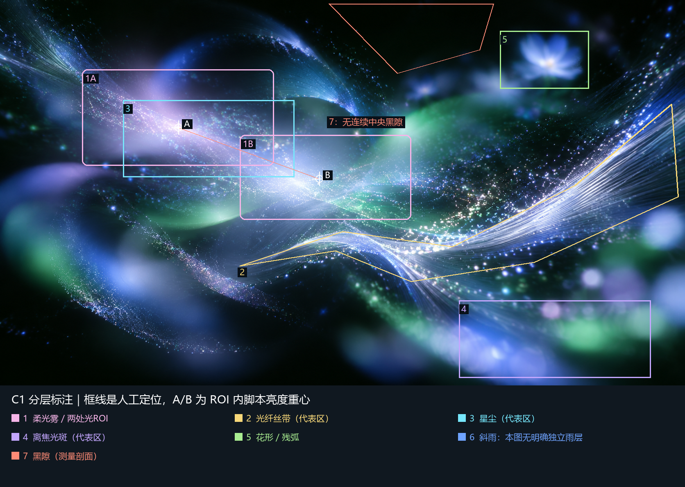
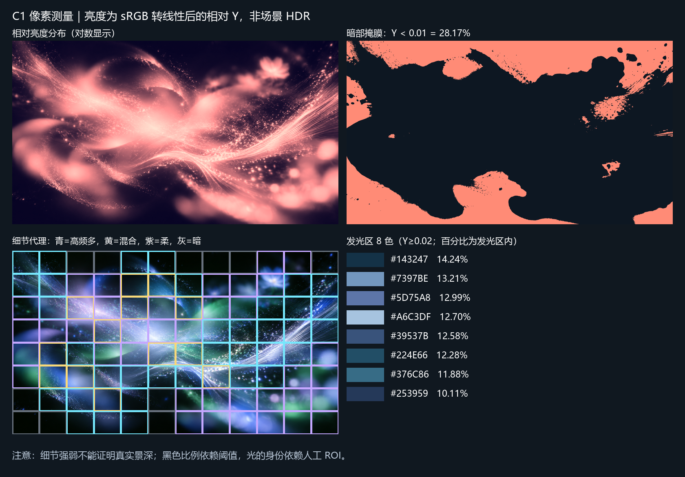
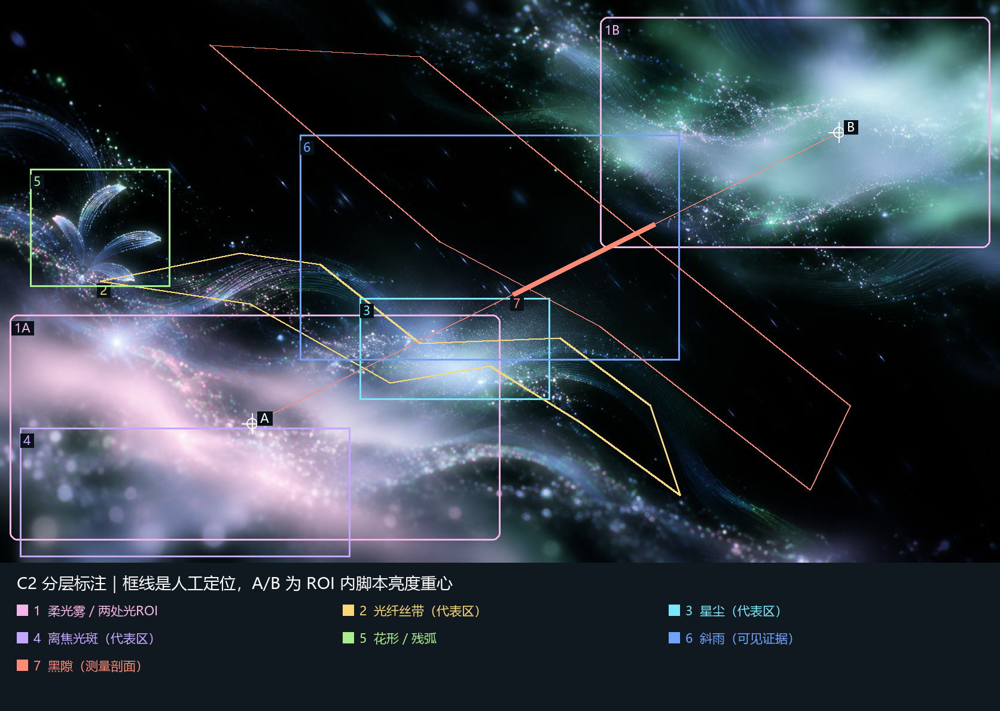
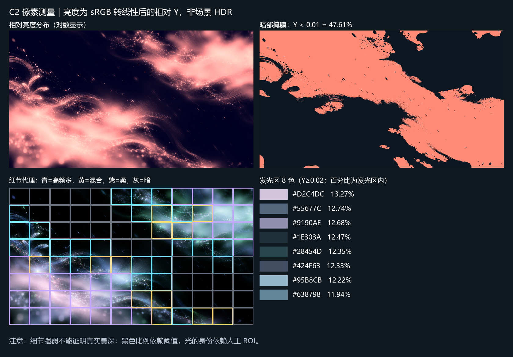
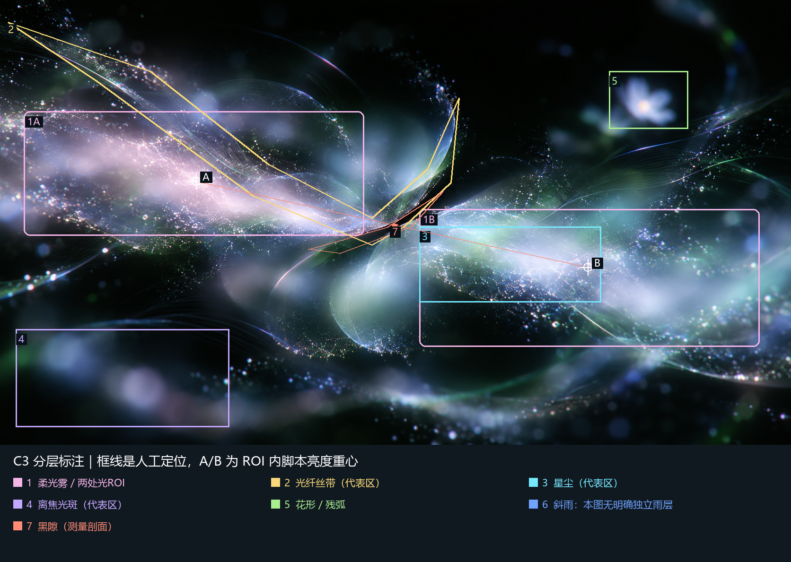
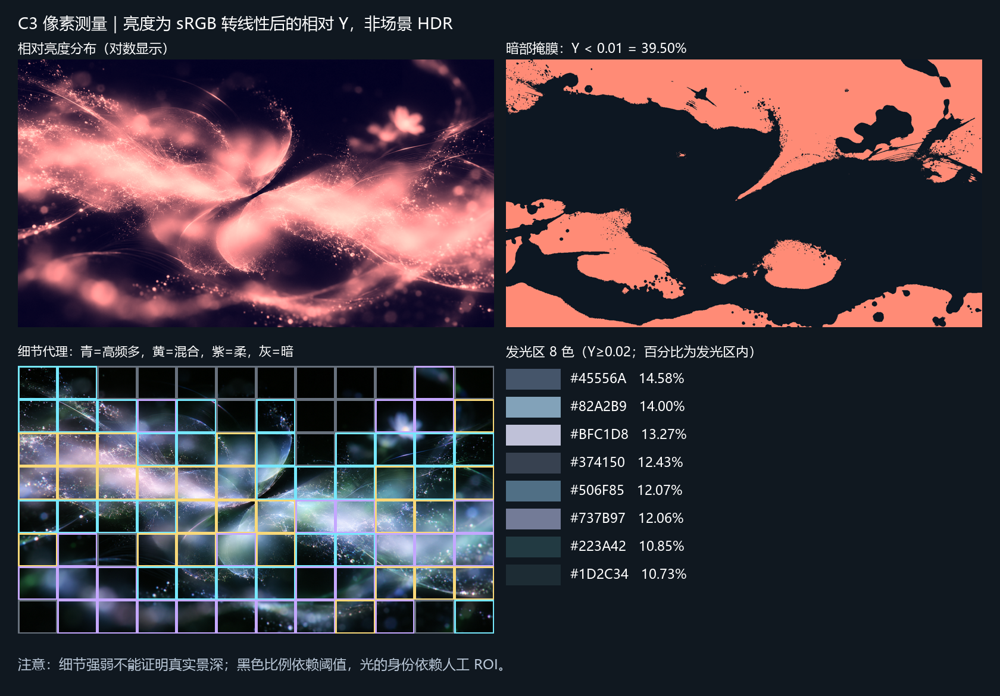
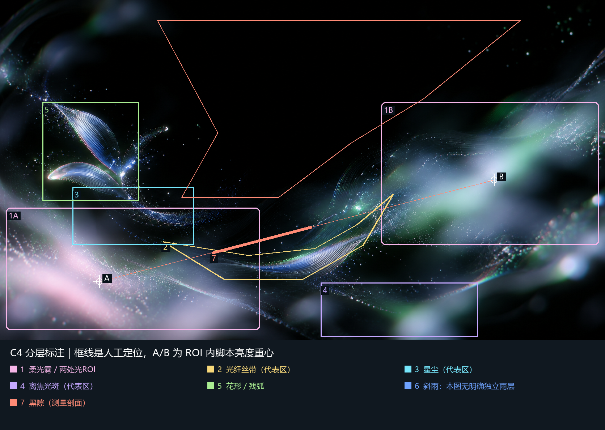
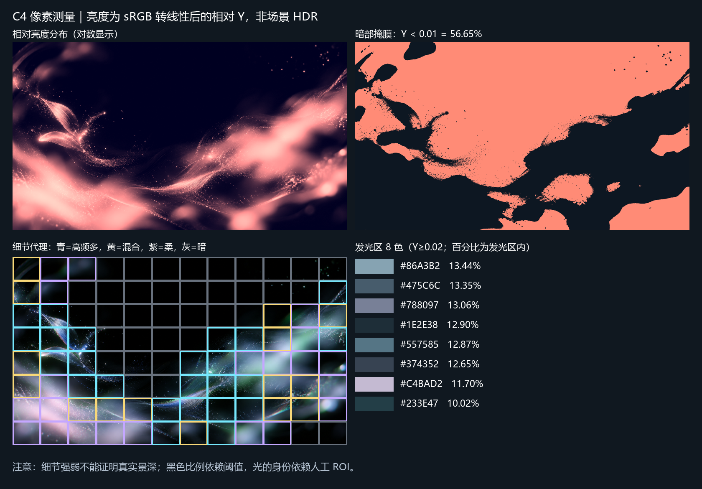

# 《晴天》四张风格帧逆向拆解

版本：方案 1.2｜2026-11-16｜图像测量已执行；本轮实施独立工程M1参数演出，M2以后才做粒子还原。

**核心判断：四张图的统一风格来自窄光纤、分布不均的星尘、半透明软雾和局部虚实差；叙事变化主要来自两光关系、黑色留白和花的完整程度。不能用一套均匀发亮的点阵替代。**

输入为四张定稿原图，每张1672×941；原图未经改写。原图：[C1](../../Assets/QingTian/ReferenceFrames/C1.png)、[C2](../../Assets/QingTian/ReferenceFrames/C2.png)、[C3](../../Assets/QingTian/ReferenceFrames/C3.png)、[C4](../../Assets/QingTian/ReferenceFrames/C4.png)。本次输出4张分层标注、4张测量图及可复核数据。标注是人工语义定位+脚本画线，不是自动语义分割；没有新生成替代风格图。

参数名字严格对应 [脚手架参数合同](脚手架方案.md)，实现依据见 [技术报告](技术报告.md)。本文件中：**测量**=按明示算法获得的图像值；**观察**=人工读图；**提案/推测**=一种可试做的粒子设置；静态原图不证明实际粒子数量、运动、深度或源渲染方法。

本拆解用于独立 `QingTianVFX`。图像测量、合同名称、范围和四章预设数值保持不变；新工程以 [DEVELOPMENT.md](../../DEVELOPMENT.md) 为唯一开发上下文与最高工程文档。当前先Windows Unity编辑器、纯黑暗幕、30fps；M1在56.80/93.61/155.41/264.05秒精确输出对应预设，不能将本拆解当作已经还原的粒子画面。iPhone（Metal/ARKit）、AR与手套后置。

## 1. 测量方法、单位与可信度

所有位置使用图片左上(0,0)、右下(1,1)。宽高分别归一化的UV距离与实际画面等比例距离不同，分别报告：dUV=sqrt(dx²+dy²)，dW=sqrt(dx²+(dy×941/1672)²)，后者以画宽为1。反向映射Unity时须翻转y和补偿aspect。

1. **色板**：Pillow median-cut量化8色，不抖动。一份是全画面8色（含黑，完整结果在JSON）；正文另列Y≥0.02的可见光区8色，给“光区内占比”和“全图占比”。颜色是量化簇代表，不是图中精确RGB出现频率，也不是原材质颜色。小面积虹彩可能被大面积蓝灰吸收，不应据色板删掉它。
2. **亮度**：将PNG解码RGB按sRGB处理，转线性后Y=0.2126R+0.7152G+0.0722B。统计均值、分位数和区间。图片已含后期/生成光效，无法反推场景HDR亮度、曝光或光源功率。
3. **黑色留白**：主阈值Y<0.01，另报0.005/0.02敏感性。它是暗像素比例，不是alpha透明度；“纯黑RGB=0”是另一统计，不与本指标混用。
4. **两处光中心**：先人工选A/B矩形ROI以排除花/前景光丝；线性Y用σ=12px高斯平滑，权重max(Y−0.01,0)，在ROI内算亮度重心，同时保存平滑后峰值位置。ROI可以重叠/包含其他层，因此这是有条件的构图标定，不能称为自动识别出两盏真实灯。C1身份尤其不确定，A/B标签保留设计意图。
5. **黑隙位置/宽度**：对Y做σ=2px平滑，在A/B重心连线采样2001点；只考察线段15%–85%，取阈值Y<0.015、最靠近中部的连续暗段；长度换算为W。标注橙色粗段是该剖面结果，细多边形是人工指出的主要留白区域。它不是整片空白最大宽度，也不是严格垂直于弯曲边界的最短距离；C3换一条剖面可能得不同宽度。C1没有暗段时记0，不代表全图没有暗部。
6. **清晰/虚化分布**：图像划成12×8格，计算显示亮度相对σ=2px低通的高频残差RMS/（可见区平均亮度+0.03）。格内Y>0.01不足10%标暗；其余按0.045/0.10阈值划为柔、混合、细节多。这是细节代理，边界/点数都会影响它；不能从单图确认真实镜头焦平面。逐帧再结合花/丝/光斑的人工观察说明。

附件：[完整测量与ROI/图块结果](风格帧拆解/测量结果.json)、[关键状态提案JSON](风格帧拆解/关键状态提案.json)、[来源核查](风格帧拆解/来源核查.md)。JSON里的 `candidate_time_s` 是保留的历史字段名，1.2已固定它的四个值；`parameters`全部名称与数值不变。图表百分比四舍五入可能有0.01%误差。

原测量脚本只读四张PNG，不触碰Unity；归档位置是 `cross-sensory-live-music/experiments/experiment-v2/06_Unity还原/风格帧拆解/测量方法.py`。它使用原归档目录和字体路径，因此新工程只保存现成JSON与PNG、不复制成一份路径失效的脚本。完整算法、阈值、ROI与图块结果已在本节和JSON中保留；若以后需重新测量，应先明确原图目录、输出目录以及Python/Pillow/NumPy/SciPy与字体条件。本次迁移不重跑测量，也不改原始数据。

### 四帧量化总览

| 帧 | 平均线性Y | 暗部Y<0.01 | 两光dUV | 两光dW | 局部黑隙剖面宽 |
|---|---|---|---|---|---|
| C1 | 0.1167 | 28.17% | 0.2454 | 0.2194 | 0.0000W / 0.0px |
| C2 | 0.1132 | 47.61% | 0.7825 | 0.6549 | 0.1585W / 265.0px |
| C3 | 0.1039 | 39.50% | 0.5317 | 0.5070 | 0.0063W / 10.6px |
| C4 | 0.0721 | 56.65% | 0.7176 | 0.6738 | 0.1708W / 285.6px |

C2比C1分离，C3比C2靠近，C4再分开，暗部比例也按28%→48%→40%→57%变化；支持“聚→分→近→散”的构图叙事。**C3并未比C1的两个ROI重心更近；C4也不是全画面光完全消失。**

### 图与VFX模块简称

下文Q=Spawn→Initialize Particle→Update Particle→Output Particle Quad；S=Spawn→Initialize Particle Strip→Update Particle→Output ParticleStrip Quad；T=贴图采样/软边/朝向；H=拟议的Custom HLSL函数。标准尺寸/颜色可用Set Size、Set Color等Block；位置与黑隙算法由HLSL求值。这里是模块级对应，不是已搭好的连线截图。Unlit输出/透明混合和默认深度限制参见[Unity输出设置](https://docs.unity3d.com/Packages/com.unity.visualeffectgraph@17.3/manual/Context-OutputSharedSettings.html)，自定义函数能力参见[Custom HLSL Block](https://docs.unity.cn/Packages/com.unity.visualeffectgraph@17.3/manual/Block-CustomHLSL.html)。

所有表内的数量、贴图、混合、速度和深度都是**提案/推测**。数量是初始可见预算，不能从生成图点数唯一反推；软光可能由少量面片模拟。花层总预算分配给软瓣片与边缘点，不能把两套预算相加重复计数。尺寸是参考画幅投影尺寸，深度是归一化0近1远；照片并未提供世界尺度。

## 2. C1｜旧光短暂聚拢

候选关键时刻：**56.80秒**，选择依据见脚手架方案。

主流场覆盖画面中下部；右前景细丝最锐，左中粉紫/白光与中央青白光相互渗入，右上小花明显柔焦。A/B只是为复刻建立的两个语义ROI，原图两光色相区分偏弱，不能当作两团分离完好的云。绿色/蓝紫弧光不应被简化成统一青色。画面上部仍有暗背景，但两光连线之间没有连续黑隙。

**清晰区域观察**：右中到右下的细丝、局部沿带微点；**柔区域观察**：右上花、左下/下方/右下边缘大光斑、后方薄雾。清晰层要有局部性。

### 像素测量

| 主色板（光区） | 光区内占比 | 全图占比 |
|---|---|---|
| #143247 | 14.24% | 9.03% |
| #7397BE | 13.21% | 8.38% |
| #5D75A8 | 12.99% | 8.24% |
| #A6C3DF | 12.70% | 8.06% |
| #39537B | 12.58% | 7.98% |
| #224E66 | 12.28% | 7.79% |
| #376C86 | 11.88% | 7.53% |
| #253959 | 10.11% | 6.41% |

光区Y≥0.02占全图 **63.41%**；上表第一种百分比合计100%，第二种合计该光区比例。其余像素是暗区，不漏算为其他色。

| 测量项 | 结果 |
|---|---|
| 平均Y / P50 / P95 / P99 | 0.1167 / 0.0483 / 0.4746 / 0.7466 |
| 亮度分箱 [0,.01)/[.01,.05)/[.05,.2)/[.2,.5)/[.5,1] | 28.17% / 22.48% / 29.70% / 15.36% / 4.29% |
| 暗部阈值Y<0.005 / 0.01 / 0.02 | 20.50% / 28.17% / 36.59% |
| 光A重心 / 平滑峰 | (0.2603, 0.3306) / (0.2566, 0.3316) |
| 光A人工ROI (x0,y0,x1,y1) | (0.12, 0.18, 0.4, 0.43) |
| 光B重心 / 平滑峰 | (0.4665, 0.4636) / (0.433, 0.4729) |
| 光B人工ROI (x0,y0,x1,y1) | (0.35, 0.35, 0.6, 0.57) |
| 两光间距 dUV / dW | 0.2454 / 0.2194 |
| 黑隙中心 / 剖面宽 | 无连续中央暗段 / 0.00000W |
| 图块面积：细节多 / 混合 / 柔 / 暗 | 36.46% / 13.54% / 38.54% / 11.46% |

图块面积以全部96格为分母，描述细节强弱，不是“多少粒子真实对焦”的比例；详情坐标与分数在测量JSON。

### 逐层反推设置

| 层 | 数量 / 尺度（推测） | 形状 / 贴图 / 混合（提案） | 运动 / 深度 / 虚实（推测） | VFX模块 |
|---|---|---|---|---|
| 柔光雾/两光 | 48片；典型0.22W，包络A/B见预设 | 长椭圆噪声alpha，软边；Premultiplied/Alpha，亮芯少量Additive | 推测：沿A/B场缓慢漂移0.045W/s；后层0.72±0.16；软 | Q + T + H：Initialize分组/SetSize；Update流场/黑隙；Output Unlit Quad |
| 光纤丝带 | 128条×32点；单丝0.0008W≈1.34px | 窄芯渐隐条纹；Unlit Additive/预乘择一校准 | 推测：随曲线相位推进，强弯曲；0.50±0.08；右前景最清楚 | S + H：Initialize Strip稳定ID；Update曲线/切线；Output ParticleStrip Quad |
| 星尘 | 6000；点径0.0006–0.0015W≈1.0–2.5px | 软圆点和少量锐小点；Additive低强度 | 推测：同场流动，局部随句收拢；0.48±0.20；虚实混合 | Q + H：SetPosition/Size/Color，按稳定ID控制密度 |
| 光斑 | 40；直径0.018–0.06W≈30–100px | 预模糊光盘/多边弱光斑；预乘低alpha | 推测：0.15±0.10近层慢漂；素材软，不让全画面同样虚 | Q + T：Orient Face Camera，较大Size，独立Gain |
| 花 | 900总预算：约8软瓣片+892边缘点；外包半径0.065W | 局部瓣弧目标/薄片，断口30%；预乘软瓣+少量加色边点 | 推测：FlowerForm=0.85时可辨，句末散开；0.85±0.04远层，Softness=0.90 | Q + H：同ID在流态/花目标间混合，两个小系统共用预算 |
| 斜雨 | 锚点0；本图没有明确独立雨层 | 不为凑齐七层添加雨贴图 | 暂无速度观察；全曲雨池可保留但不可见 | Rain图权重为0 |
| 黑隙/虚实 | 中央GapWidth=0；全图暗部仍28.17% | 没有黑色面片；用流场自身疏密留白 | 景深为推测；保留右清晰、后花柔焦 | 共享H遮罩在本帧Strength=0；软硬贴图代理 |

### 本帧关键状态参数表

以下是一份可试做的章节基态，不包含运行时RMS/Beat/FlowPhase。中心和黑隙由上述条件测量初始化；其余是人工造型/性能初值，不能当成算法从图片恢复的真值。颜色独立调成粉/青身份，不等于量化色板直接贴进HDR。

| 参数名（与合同一致） | 具体值 | 性质 |
|---|---|---|
| LightCenterA | (0.2603, 0.3306) | 测量初值（依赖ROI/阈值） |
| LightCenterB | (0.4665, 0.4636) | 测量初值（依赖ROI/阈值） |
| LightScaleA | (0.26, 0.2) | 提案/推测 |
| LightScaleB | (0.3, 0.22) | 提案/推测 |
| LightColorA | #D1CEFA | 提案/推测 |
| LightColorB | #BCE8F0 | 提案/推测 |
| LightGainA | 1.05 | 提案/推测 |
| LightGainB | 1.15 | 提案/推测 |
| MistTargetCount | 48 | 提案/推测 |
| MistSize | 0.22 | 提案/推测 |
| MistOpacity | 0.14 | 提案/推测 |
| FlowSpeed | 0.045 | 提案/推测 |
| FiberTargetCount | 128 | 提案/推测 |
| FiberWidth | 0.0008 | 提案/推测 |
| FiberBend | 0.75 | 提案/推测 |
| NoiseAmp | 0.006 | 提案/推测 |
| DustTargetCount | 6000 | 提案/推测 |
| DustSize | (0.0006, 0.0015) | 提案/推测 |
| DustGain | 1.1 | 提案/推测 |
| BokehTargetCount | 40 | 提案/推测 |
| BokehSize | (0.018, 0.06) | 提案/推测 |
| BokehGain | 0.32 | 提案/推测 |
| FlowerCenter | (0.795, 0.155) | 提案/推测 |
| FlowerRadius | 0.065 | 提案/推测 |
| FlowerForm | 0.85 | 提案/推测 |
| FlowerBreak | 0.3 | 提案/推测 |
| FlowerTargetCount | 900 | 提案/推测 |
| FlowerSoftness | 0.9 | 提案/推测 |
| RainTargetCount | 0 | 提案/推测 |
| RainLength | 0.018 | 提案/推测 |
| RainWidth | 0.0006 | 提案/推测 |
| RainAngle | 48 | 提案/推测 |
| RainSpeed | 0.16 | 提案/推测 |
| GapLength | 0.45 | 提案/推测 |
| DepthSpread | 0.7 | 提案/推测 |
| SoftFraction | 0.65 | 提案/推测 |
| BloomIntensity | 0.65 | 提案/推测 |
| NoiseFrequency | 6 | 提案/推测 |
| GapCenter | (0.5, 0.5) | 占位；GapStrength=0，不生效 |
| GapWidth | 0 | 测量初值（依赖ROI/阈值） |
| GapNormalAngle | 0 | 占位；GapStrength=0，不生效 |
| GapStrength | 0 | 提案/推测 |
| FocusDepth | 0.5 | 提案/推测 |
| FlowA0 | (0, 0.1, 0.5) | 人工曲线起点；非自动拟合 |
| FlowA1 | (0.25, 0.65, 0.5) | 人工曲线起点；非自动拟合 |
| FlowA2 | (0.65, 0.95, 0.5) | 人工曲线起点；非自动拟合 |
| FlowA3 | (1.05, 0.28, 0.5) | 人工曲线起点；非自动拟合 |
| FlowB0 | (0.05, 0.65, 0.75) | 人工曲线起点；非自动拟合 |
| FlowB1 | (0.4, 0.22, 0.6) | 人工曲线起点；非自动拟合 |
| FlowB2 | (0.65, 0.17, 0.75) | 人工曲线起点；非自动拟合 |
| FlowB3 | (1.05, 0.9, 0.82) | 人工曲线起点；非自动拟合 |

每层深度另见第6节公共设置；花层C1/C3为远层0.85，C2为0.52、C4为0.50；只在散开过渡阶段换深度。条带32采样点和固定容量不是每帧暴露参数。原图SHA-256：`3e7f8d5c3ec81f8cc5f2c22f35e98e056d921e6ca84bf2dad72c92197a314375`。

## 3. C2｜雨把光分开

候选关键时刻：**93.61秒**，选择依据见脚手架方案。

左下粉光、右上青光构成明显对角分离；中央斜向深黑通道仅有细雨穿过。左缘不是完全消失的花，而是几条仍可辨瓣弧的残片。前景花弧与部分丝线较锐，雾团和左下大光斑柔。这里“成形”句可表现为雨幕方向短暂一致，不能要求花开满。

**清晰区域观察**：左缘弧片、两侧带状微点、中央少量细雨；**柔区域观察**：左下粉雾和右上青雾的内层。黑通道位置与宽度比单纯降总亮度重要。

### 像素测量

| 主色板（光区） | 光区内占比 | 全图占比 |
|---|---|---|
| #D2C4DC | 13.27% | 6.25% |
| #55677C | 12.74% | 6.00% |
| #9190AE | 12.68% | 5.97% |
| #1E303A | 12.47% | 5.87% |
| #28454D | 12.35% | 5.82% |
| #424F63 | 12.33% | 5.81% |
| #95B8CB | 12.22% | 5.76% |
| #638798 | 11.94% | 5.62% |

光区Y≥0.02占全图 **47.11%**；上表第一种百分比合计100%，第二种合计该光区比例。其余像素是暗区，不漏算为其他色。

| 测量项 | 结果 |
|---|---|
| 平均Y / P50 / P95 / P99 | 0.1132 / 0.0137 / 0.5400 / 0.7085 |
| 亮度分箱 [0,.01)/[.01,.05)/[.05,.2)/[.2,.5)/[.5,1] | 47.61% / 13.88% / 16.92% / 15.40% / 6.18% |
| 暗部阈值Y<0.005 / 0.01 / 0.02 | 42.14% / 47.61% / 52.89% |
| 光A重心 / 平滑峰 | (0.2523, 0.7531) / (0.1842, 0.779) |
| 光A人工ROI (x0,y0,x1,y1) | (0.01, 0.56, 0.5, 0.96) |
| 光B重心 / 平滑峰 | (0.8387, 0.2349) / (0.872, 0.17) |
| 光B人工ROI (x0,y0,x1,y1) | (0.6, 0.03, 0.99, 0.44) |
| 两光间距 dUV / dW | 0.7825 / 0.6549 |
| 黑隙中心 / 剖面宽 | (0.5842, 0.4598) / 0.15847W |
| 图块面积：细节多 / 混合 / 柔 / 暗 | 25.00% / 12.50% / 31.25% / 31.25% |

图块面积以全部96格为分母，描述细节强弱，不是“多少粒子真实对焦”的比例；详情坐标与分数在测量JSON。

### 逐层反推设置

| 层 | 数量 / 尺度（推测） | 形状 / 贴图 / 混合（提案） | 运动 / 深度 / 虚实（推测） | VFX模块 |
|---|---|---|---|---|
| 柔光雾/两光 | 32片；典型0.24W | 两团长雾，A粉/B青，中心透黑；预乘/Alpha | 推测0.055W/s沿两侧滑行；0.72±0.16；软 | Q + T + H；独立A/B中心、Scale/Gain |
| 光纤丝带 | 80条×32点；0.00065W≈1.09px | 细亮芯断续；Unlit加色或预乘 | 推测两侧流动，绕开中央；0.50±0.08；局部锐 | S + H；Gap场限制轨迹/alpha |
| 星尘 | 4200；0.0005–0.0013W≈0.84–2.17px | 沿两团外缘渐稀小点；Additive | 推测句内只局部集束，保持分离；0.48±0.20 | Q + H；密度场共用A/B曲线 |
| 光斑 | 28；0.015–0.045W≈25–75px | 左下较多软光盘；预乘低alpha | 推测近层0.15±0.10，慢漂移；软 | Q + T；独立Gain=0.22 |
| 花/残弧 | 420总预算：约6薄片+414边缘点；半径0.075W | 左侧开口短弧；断口65%，不是完整花贴图 | 推测Form=0.30，沿边碎落；0.52±0.04，部分较清楚 | Q + H；降低目标权重但保留几段可辨薄弧 |
| 斜雨 | 120；长0.020W≈33px，宽0.0005W≈0.84px | 细渐隐长条；低强度Additive | 推测屏幕右下48°、0.18W/s；0.60±0.18；少数较清 | Q + Orient Fixed Axis + H；角度符号按图片坐标翻译 |
| 黑隙/虚实 | 局部剖面0.1585W≈265px；暗部47.61% | 中央保护区；雨采用较弱排斥，不能被雾填满 | 深度为推测，近点锐/大团软 | 共享H；GapStrength=1，雨只取其0.35倍 |

### 本帧关键状态参数表

以下是一份可试做的章节基态，不包含运行时RMS/Beat/FlowPhase。中心和黑隙由上述条件测量初始化；其余是人工造型/性能初值，不能当成算法从图片恢复的真值。颜色独立调成粉/青身份，不等于量化色板直接贴进HDR。

| 参数名（与合同一致） | 具体值 | 性质 |
|---|---|---|
| LightCenterA | (0.2523, 0.7531) | 测量初值（依赖ROI/阈值） |
| LightCenterB | (0.8387, 0.2349) | 测量初值（依赖ROI/阈值） |
| LightScaleA | (0.36, 0.25) | 提案/推测 |
| LightScaleB | (0.32, 0.25) | 提案/推测 |
| LightColorA | #E2BCD7 | 提案/推测 |
| LightColorB | #B7E6E8 | 提案/推测 |
| LightGainA | 1 | 提案/推测 |
| LightGainB | 1.1 | 提案/推测 |
| MistTargetCount | 32 | 提案/推测 |
| MistSize | 0.24 | 提案/推测 |
| MistOpacity | 0.12 | 提案/推测 |
| FlowSpeed | 0.055 | 提案/推测 |
| FiberTargetCount | 80 | 提案/推测 |
| FiberWidth | 0.0006 | 提案/推测 |
| FiberBend | 0.5 | 提案/推测 |
| NoiseAmp | 0.004 | 提案/推测 |
| DustTargetCount | 4200 | 提案/推测 |
| DustSize | (0.0005, 0.0013) | 提案/推测 |
| DustGain | 0.95 | 提案/推测 |
| BokehTargetCount | 28 | 提案/推测 |
| BokehSize | (0.015, 0.045) | 提案/推测 |
| BokehGain | 0.22 | 提案/推测 |
| FlowerCenter | (0.1, 0.405) | 提案/推测 |
| FlowerRadius | 0.075 | 提案/推测 |
| FlowerForm | 0.3 | 提案/推测 |
| FlowerBreak | 0.65 | 提案/推测 |
| FlowerTargetCount | 420 | 提案/推测 |
| FlowerSoftness | 0.35 | 提案/推测 |
| RainTargetCount | 120 | 提案/推测 |
| RainLength | 0.02 | 提案/推测 |
| RainWidth | 0.0005 | 提案/推测 |
| RainAngle | 48 | 提案/推测 |
| RainSpeed | 0.18 | 提案/推测 |
| GapLength | 0.85 | 提案/推测 |
| DepthSpread | 0.65 | 提案/推测 |
| SoftFraction | 0.6 | 提案/推测 |
| BloomIntensity | 0.45 | 提案/推测 |
| NoiseFrequency | 6 | 提案/推测 |
| GapCenter | (0.5842, 0.4598) | 测量初值（依赖ROI/阈值） |
| GapWidth | 0.1585 | 测量初值（依赖ROI/阈值） |
| GapNormalAngle | -55 | 提案/推测 |
| GapStrength | 1 | 提案/推测 |
| FocusDepth | 0.5 | 提案/推测 |
| FlowA0 | (0, 0.35, 0.5) | 人工曲线起点；非自动拟合 |
| FlowA1 | (0.3, 0.28, 0.5) | 人工曲线起点；非自动拟合 |
| FlowA2 | (0.5, 0.95, 0.6) | 人工曲线起点；非自动拟合 |
| FlowA3 | (0.85, 1.05, 0.7) | 人工曲线起点；非自动拟合 |
| FlowB0 | (0.35, -0.1, 0.8) | 人工曲线起点；非自动拟合 |
| FlowB1 | (0.65, 0.3, 0.65) | 人工曲线起点；非自动拟合 |
| FlowB2 | (0.85, 0.6, 0.65) | 人工曲线起点；非自动拟合 |
| FlowB3 | (1.05, 0.22, 0.6) | 人工曲线起点；非自动拟合 |

每层深度另见第6节公共设置；花层C1/C3为远层0.85，C2为0.52、C4为0.50；只在散开过渡阶段换深度。条带32采样点和固定容量不是每帧暴露参数。原图SHA-256：`02c58fb930698ca3bc3ae0b74a39b7f304141ff111682a814c0875ef0326557a`。

## 4. C3｜又近了一点

候选关键时刻：**155.41秒**，选择依据见脚手架方案。

两光沿回旋结构伸向中央，最内侧边缘几乎接触但保留一条弯曲细缝；不是两团最亮区重合成白核。右上小花退后柔焦。原图最细黑段只有约11px，调Bloom/噪声要非常克制；应先关Bloom完成几何和排斥场再恢复柔光。

**清晰区域观察**：左侧/中部细粒、缝两边弧面边缘、右侧部分颗粒；**柔区域观察**：右上花、下方前景光盘、光团内部和上下散光。这里“靠近”主要靠两光内缘延伸，不只是把重心向中点拉。

### 像素测量

| 主色板（光区） | 光区内占比 | 全图占比 |
|---|---|---|
| #45556A | 14.58% | 7.58% |
| #82A2B9 | 14.00% | 7.28% |
| #BFC1D8 | 13.27% | 6.90% |
| #374150 | 12.43% | 6.46% |
| #506F85 | 12.07% | 6.27% |
| #737B97 | 12.06% | 6.27% |
| #223A42 | 10.85% | 5.64% |
| #1D2C34 | 10.73% | 5.58% |

光区Y≥0.02占全图 **51.97%**；上表第一种百分比合计100%，第二种合计该光区比例。其余像素是暗区，不漏算为其他色。

| 测量项 | 结果 |
|---|---|
| 平均Y / P50 / P95 / P99 | 0.1039 / 0.0232 / 0.4918 / 0.7141 |
| 亮度分箱 [0,.01)/[.01,.05)/[.05,.2)/[.2,.5)/[.5,1] | 39.50% / 21.32% / 20.75% / 13.65% / 4.77% |
| 暗部阈值Y<0.005 / 0.01 / 0.02 | 30.73% / 39.50% / 48.03% |
| 光A重心 / 平滑峰 | (0.2479, 0.4076) / (0.378, 0.4846) |
| 光A人工ROI (x0,y0,x1,y1) | (0.03, 0.25, 0.46, 0.53) |
| 光B重心 / 平滑峰 | (0.7431, 0.6014) / (0.6842, 0.593) |
| 光B人工ROI (x0,y0,x1,y1) | (0.53, 0.47, 0.96, 0.78) |
| 两光间距 dUV / dW | 0.5317 / 0.5070 |
| 黑隙中心 / 剖面宽 | (0.4988, 0.5058) / 0.00634W |
| 图块面积：细节多 / 混合 / 柔 / 暗 | 30.21% / 27.08% / 26.04% / 16.67% |

图块面积以全部96格为分母，描述细节强弱，不是“多少粒子真实对焦”的比例；详情坐标与分数在测量JSON。

### 逐层反推设置

| 层 | 数量 / 尺度（推测） | 形状 / 贴图 / 混合（提案） | 运动 / 深度 / 虚实（推测） | VFX模块 |
|---|---|---|---|---|
| 柔光雾/两光 | 40片；典型0.23W | 沿回旋伸长，亮芯两侧独立；预乘 | 推测0.035W/s；0.72±0.16软后景 | Q + T + H；形态先伸向内缘再调中心 |
| 光纤丝带 | 96条×32点；0.00065W≈1.09px | 薄弧边和回旋细丝，低亮加色 | 推测靠近时仍流动；0.50±0.08；局部清晰 | S + H；曲线不得穿过受保护黑缝 |
| 星尘 | 5200；0.0005–0.0014W≈0.84–2.34px | 内缘有亮点但不桥接黑缝；Additive | 推测随句小幅聚拢；0.48±0.20混合 | Q + H；最后施加Gap抑制，不能在它之后再加大位移 |
| 光斑 | 32；0.015–0.045W≈25–75px | 底部/边缘柔盘；预乘低alpha | 推测0.15±0.10；软，不覆盖缝口 | Q + T；Gain=0.25 |
| 花 | 700总预算：约8软瓣片+692边缘点；半径0.05W | 右上小花，断口35%；软片+微点 | 推测Form=0.80；0.85±0.04远层，Softness=0.95 | Q + H；一次聚成后继续微小变形，不暂停 |
| 斜雨 | 锚点0；从C2过渡时已渐隐 | 不把所有孤立点当雨 | 无独立雨运动证据 | Rain权重0 |
| 黑隙/虚实 | 局部剖面0.00634W≈10.6px；暗部39.50% | 中心附近弯曲细缝；无黑遮挡板 | 推测：噪声幅度降至0.003W，Bloom初值0.35 | 共享H局部场；必须看后处理最终结果 |

### 本帧关键状态参数表

以下是一份可试做的章节基态，不包含运行时RMS/Beat/FlowPhase。中心和黑隙由上述条件测量初始化；其余是人工造型/性能初值，不能当成算法从图片恢复的真值。颜色独立调成粉/青身份，不等于量化色板直接贴进HDR。

| 参数名（与合同一致） | 具体值 | 性质 |
|---|---|---|
| LightCenterA | (0.2479, 0.4076) | 测量初值（依赖ROI/阈值） |
| LightCenterB | (0.7431, 0.6014) | 测量初值（依赖ROI/阈值） |
| LightScaleA | (0.33, 0.24) | 提案/推测 |
| LightScaleB | (0.36, 0.25) | 提案/推测 |
| LightColorA | #DEC8E1 | 提案/推测 |
| LightColorB | #B6DFE9 | 提案/推测 |
| LightGainA | 1.05 | 提案/推测 |
| LightGainB | 1 | 提案/推测 |
| MistTargetCount | 40 | 提案/推测 |
| MistSize | 0.23 | 提案/推测 |
| MistOpacity | 0.12 | 提案/推测 |
| FlowSpeed | 0.035 | 提案/推测 |
| FiberTargetCount | 96 | 提案/推测 |
| FiberWidth | 0.0006 | 提案/推测 |
| FiberBend | 0.85 | 提案/推测 |
| NoiseAmp | 0.003 | 提案/推测 |
| DustTargetCount | 5200 | 提案/推测 |
| DustSize | (0.0005, 0.0014) | 提案/推测 |
| DustGain | 1 | 提案/推测 |
| BokehTargetCount | 32 | 提案/推测 |
| BokehSize | (0.015, 0.045) | 提案/推测 |
| BokehGain | 0.25 | 提案/推测 |
| FlowerCenter | (0.82, 0.225) | 提案/推测 |
| FlowerRadius | 0.05 | 提案/推测 |
| FlowerForm | 0.8 | 提案/推测 |
| FlowerBreak | 0.35 | 提案/推测 |
| FlowerTargetCount | 700 | 提案/推测 |
| FlowerSoftness | 0.95 | 提案/推测 |
| RainTargetCount | 0 | 提案/推测 |
| RainLength | 0.018 | 提案/推测 |
| RainWidth | 0.0005 | 提案/推测 |
| RainAngle | 48 | 提案/推测 |
| RainSpeed | 0.16 | 提案/推测 |
| GapLength | 0.28 | 提案/推测 |
| DepthSpread | 0.75 | 提案/推测 |
| SoftFraction | 0.6 | 提案/推测 |
| BloomIntensity | 0.35 | 提案/推测 |
| NoiseFrequency | 6 | 提案/推测 |
| GapCenter | (0.4988, 0.5058) | 测量初值（依赖ROI/阈值） |
| GapWidth | 0.0063 | 测量初值（依赖ROI/阈值） |
| GapNormalAngle | 60 | 提案/推测 |
| GapStrength | 1 | 提案/推测 |
| FocusDepth | 0.5 | 提案/推测 |
| FlowA0 | (0, 0.06, 0.5) | 人工曲线起点；非自动拟合 |
| FlowA1 | (0.35, 0.5, 0.5) | 人工曲线起点；非自动拟合 |
| FlowA2 | (0.64, 0.64, 0.6) | 人工曲线起点；非自动拟合 |
| FlowA3 | (0.57, 0.2, 0.65) | 人工曲线起点；非自动拟合 |
| FlowB0 | (1.05, 0.72, 0.65) | 人工曲线起点；非自动拟合 |
| FlowB1 | (0.7, 0.7, 0.6) | 人工曲线起点；非自动拟合 |
| FlowB2 | (0.22, 0.7, 0.55) | 人工曲线起点；非自动拟合 |
| FlowB3 | (0.51, 0.48, 0.5) | 人工曲线起点；非自动拟合 |

每层深度另见第6节公共设置；花层C1/C3为远层0.85，C2为0.52、C4为0.50；只在散开过渡阶段换深度。条带32采样点和固定容量不是每帧暴露参数。原图SHA-256：`8326fb052e428bd3dfc446b5be629c2442d0417b4b0aced46ca9f313bd3bda71`。

## 5. C4｜只剩经过的光

候选关键时刻：**264.05秒**，选择依据见脚手架方案。

上方与中央形成大片留白，左下粉光和右侧青光沿两侧退散；下方光纤绕过黑区。左缘两瓣状短弧依然完整可辨，不能测完后宣称“只剩不可辨的粉尘”。右侧青光还很明显，所以关键状态保留它，在该时刻之后继续淡出才符合“散”。

**清晰区域观察**：左缘弧片、下中部少量光丝、右缘细点；**柔区域观察**：左右两光的内核和下缘光盘。大部分中央/上部是暗区，不应把“没纹理的黑”统计成“失焦”。

### 像素测量

| 主色板（光区） | 光区内占比 | 全图占比 |
|---|---|---|
| #86A3B2 | 13.44% | 4.97% |
| #475C6C | 13.35% | 4.94% |
| #788097 | 13.06% | 4.83% |
| #1E2E38 | 12.90% | 4.77% |
| #557585 | 12.87% | 4.76% |
| #374352 | 12.65% | 4.68% |
| #C4BAD2 | 11.70% | 4.33% |
| #233E47 | 10.02% | 3.71% |

光区Y≥0.02占全图 **36.98%**；上表第一种百分比合计100%，第二种合计该光区比例。其余像素是暗区，不漏算为其他色。

| 测量项 | 结果 |
|---|---|
| 平均Y / P50 / P95 / P99 | 0.0721 / 0.0052 / 0.3954 / 0.6238 |
| 亮度分箱 [0,.01)/[.01,.05)/[.05,.2)/[.2,.5)/[.5,1] | 56.65% / 15.14% / 14.77% / 10.58% / 2.86% |
| 暗部阈值Y<0.005 / 0.01 / 0.02 | 49.67% / 56.65% / 63.02% |
| 光A重心 / 平滑峰 | (0.1642, 0.8275) / (0.0885, 0.8225) |
| 光A人工ROI (x0,y0,x1,y1) | (0.01, 0.61, 0.43, 0.97) |
| 光B重心 / 平滑峰 | (0.8167, 0.5288) / (0.8212, 0.4973) |
| 光B人工ROI (x0,y0,x1,y1) | (0.63, 0.3, 0.99, 0.72) |
| 两光间距 dUV / dW | 0.7176 / 0.6738 |
| 黑隙中心 / 剖面宽 | (0.4325, 0.7046) / 0.17081W |
| 图块面积：细节多 / 混合 / 柔 / 暗 | 25.00% / 15.62% / 21.88% / 37.50% |

图块面积以全部96格为分母，描述细节强弱，不是“多少粒子真实对焦”的比例；详情坐标与分数在测量JSON。

### 逐层反推设置

| 层 | 数量 / 尺度（推测） | 形状 / 贴图 / 混合（提案） | 运动 / 深度 / 虚实（推测） | VFX模块 |
|---|---|---|---|---|
| 柔光雾/两光 | 24片；典型0.25W | A左下较弱，B右侧仍清楚；预乘 | 推测0.025W/s向画外经过；0.72±0.16软 | Q + T + H；关键帧后继续降低Gain而非提前消失 |
| 光纤丝带 | 64条×32点；0.0006W≈1.0px | 下方细弧，中央不加密；低亮加色 | 推测沿边退散；0.50±0.08局部锐 | S + H；外缘流线避开上部黑场 |
| 星尘 | 2200；0.0005–0.0012W≈0.84–2.01px | 沿光边稀疏微点；低强度Additive | 推测密度向末尾递减；0.48±0.20 | Q + H；散开优先减密度/alpha，不全部变大 |
| 光斑 | 20；0.015–0.05W≈25–84px | 底边少量软盘；预乘 | 推测近层0.15±0.10；慢漂，不强闪 | Q + T；Gain=0.18 |
| 花/残弧 | 280总预算：约4薄片+276边点；半径0.085W | 左边两段明显弧片，断口78%；边缘细粒化 | 推测Form=0.22；0.50±0.04，残弧较锐；并非远景小软花 | Q + H；保留可辨两弧后继续消解 |
| 斜雨 | 锚点0 | 没有充分证据单设雨 | 不虚构速度 | Rain权重0 |
| 黑隙/虚实 | 剖面0.1708W≈286px；全图暗部56.65% | 上部/中央留白远大于这一局部剖面；不画黑片 | 推测更稀更慢，焦点主层不乱跑 | 共享H；GapLength=1.10是宽范围提案，不是测量 |

### 本帧关键状态参数表

以下是一份可试做的章节基态，不包含运行时RMS/Beat/FlowPhase。中心和黑隙由上述条件测量初始化；其余是人工造型/性能初值，不能当成算法从图片恢复的真值。颜色独立调成粉/青身份，不等于量化色板直接贴进HDR。

| 参数名（与合同一致） | 具体值 | 性质 |
|---|---|---|
| LightCenterA | (0.1642, 0.8275) | 测量初值（依赖ROI/阈值） |
| LightCenterB | (0.8167, 0.5288) | 测量初值（依赖ROI/阈值） |
| LightScaleA | (0.3, 0.22) | 提案/推测 |
| LightScaleB | (0.29, 0.24) | 提案/推测 |
| LightColorA | #D9BCD6 | 提案/推测 |
| LightColorB | #AED6DE | 提案/推测 |
| LightGainA | 0.75 | 提案/推测 |
| LightGainB | 0.95 | 提案/推测 |
| MistTargetCount | 24 | 提案/推测 |
| MistSize | 0.25 | 提案/推测 |
| MistOpacity | 0.09 | 提案/推测 |
| FlowSpeed | 0.025 | 提案/推测 |
| FiberTargetCount | 64 | 提案/推测 |
| FiberWidth | 0.0006 | 提案/推测 |
| FiberBend | 0.4 | 提案/推测 |
| NoiseAmp | 0.004 | 提案/推测 |
| DustTargetCount | 2200 | 提案/推测 |
| DustSize | (0.0005, 0.0012) | 提案/推测 |
| DustGain | 0.7 | 提案/推测 |
| BokehTargetCount | 20 | 提案/推测 |
| BokehSize | (0.015, 0.05) | 提案/推测 |
| BokehGain | 0.18 | 提案/推测 |
| FlowerCenter | (0.15, 0.445) | 提案/推测 |
| FlowerRadius | 0.085 | 提案/推测 |
| FlowerForm | 0.22 | 提案/推测 |
| FlowerBreak | 0.78 | 提案/推测 |
| FlowerTargetCount | 280 | 提案/推测 |
| FlowerSoftness | 0.35 | 提案/推测 |
| RainTargetCount | 0 | 提案/推测 |
| RainLength | 0.018 | 提案/推测 |
| RainWidth | 0.0005 | 提案/推测 |
| RainAngle | 48 | 提案/推测 |
| RainSpeed | 0.16 | 提案/推测 |
| GapLength | 1.1 | 提案/推测 |
| DepthSpread | 0.65 | 提案/推测 |
| SoftFraction | 0.55 | 提案/推测 |
| BloomIntensity | 0.3 | 提案/推测 |
| NoiseFrequency | 6 | 提案/推测 |
| GapCenter | (0.4325, 0.7046) | 测量初值（依赖ROI/阈值） |
| GapWidth | 0.1708 | 测量初值（依赖ROI/阈值） |
| GapNormalAngle | -15 | 提案/推测 |
| GapStrength | 1 | 提案/推测 |
| FocusDepth | 0.5 | 提案/推测 |
| FlowA0 | (0, 0.55, 0.6) | 人工曲线起点；非自动拟合 |
| FlowA1 | (0.3, 0.9, 0.5) | 人工曲线起点；非自动拟合 |
| FlowA2 | (0.45, 0.9, 0.5) | 人工曲线起点；非自动拟合 |
| FlowA3 | (0.68, 0.55, 0.5) | 人工曲线起点；非自动拟合 |
| FlowB0 | (0.6, 0.6, 0.7) | 人工曲线起点；非自动拟合 |
| FlowB1 | (0.8, 0.55, 0.65) | 人工曲线起点；非自动拟合 |
| FlowB2 | (0.94, 0.45, 0.8) | 人工曲线起点；非自动拟合 |
| FlowB3 | (1.05, 0.15, 0.8) | 人工曲线起点；非自动拟合 |

每层深度另见第6节公共设置；花层C1/C3为远层0.85，C2为0.52、C4为0.50；只在散开过渡阶段换深度。条带32采样点和固定容量不是每帧暴露参数。原图SHA-256：`ad32bdb03e8f8ed297038f47ea2cb37a0c52586ef1626651b3bfb7ba0507c39f`。

## 6. 四章共用项、变化项与“聚→分→近→散”

### 保持统一的部分

统一为冷蓝/青绿/冷白的主流场，粉/青的两处光，少量虹彩边缘；不为每章发明新的材质风格。统一条带拓扑、固定随机种子、软边贴图家族和同一相机。C1原图确实比C2–C4更偏清晰光纤、冷蓝高饱和，属于已定稿差异，不应强行调成一张图的四种颜色。

推荐共有：NoiseFrequency=6，FocusDepth=0.50；星尘小点径约1–2.5px、光纤约1px、大光斑约25–100px形成三级尺度；固定128条×32点的最大条带容量，尘8192、花1024、雾64、光斑64、雨256，总槽位13696。这是M2以后在Windows编辑器试做的初始视觉预算，不是性能结论。C1可见目标最多约11084，C2约7360，C3约9044，C4约4572；额外Output、排序与大面片面积仍要计成本。未来iPhone阶段另测，不据此承诺手机能力。

| 图层 | LayerDepth | LayerDepthJitter | 虚实用途（均为推测） |
|---|---:|---:|---|
| Mist | 0.72 | 0.16 | 中后层软雾，不能盖满前景 |
| Fibers | 0.50 | 0.08 | 主清晰平面附近，局部窄丝锐 |
| Dust | 0.48 | 0.20 | 混合近远微点；尺寸/软硬按深度权重 |
| Bokeh | 0.15 | 0.10 | 近层大软盘，远层的软感主要由Mist承担 |
| Flower | C1/C3=0.85；C2=0.52；C4=0.50 | 0.04 | 成花退后柔焦，残弧靠主平面更清；章内不乱拉焦 |
| Rain | 0.60 | 0.18 | 稀疏雨线有深度差，C2以外锚点不可见 |

**贴图/材质共用提案**：小点64–128px软圆盘、光斑128–256px柔盘、雾256–512px低频带空洞alpha、细丝64×256窄芯渐隐条、雨32×128长条渐隐；花用参数瓣弧目标和局部软片。以上都是未来素材规格，尚未创建，也不意味着应把整张风格帧当贴图。先一张贴图一个简单Output验证，再考虑图集。纯发光Unlit、少量Bloom、默认不做真DOF，减小手机填充和透明排序压力。

### 章节变化与实证边界

| 指标 | C1 聚 | C2 分 | C3 近 | C4 散 |
|---|---|---|---|---|
| 两光间距 dW（条件测量） | 0.219 | 0.655 | 0.507 | 0.674 |
| 暗部占比（测量Y<.01） | 28.17% | 47.61% | 39.50% | 56.65% |
| 黑隙局部剖面宽W（条件测量） | 0.0000 | 0.1585 | 0.0063 | 0.1708 |
| 可见光纤条数（推测） | 128 | 80 | 96 | 64 |
| 星尘预算（推测） | 6000 | 4200 | 5200 | 2200 |
| 花Form（提案） | 0.85 | 0.3 | 0.8 | 0.22 |
| 花Break（提案） | 0.3 | 0.65 | 0.35 | 0.78 |
| 雨可见目标（提案） | 0 | 120 | 0 | 0 |
| FlowSpeed W/s（推测） | 0.045 | 0.055 | 0.035 | 0.025 |
| BloomIntensity（提案） | 0.65 | 0.45 | 0.35 | 0.3 |

测量支持的是关系变化：C1重叠、C2对角分离、C3内缘靠近但不合并、C4留白扩大。**运动方向、速度、真实深度、粒子寿命、吸附强度、条带段数和HDR乘数无法由静图确定**，必须在视频和真机中调。C2雨方向可观察为斜线，但右下运动是叙事推测，静图也可能是反向运动。

C4平均亮度最低但右侧仍明显。方案在264.05秒经过这张图，再按尾音向外散去，而不是为了“散”字删掉原图右光。C3中心近不等于中心更亮：保护细缝应优先于增加Bloom。C1的两光色相区分偏弱、C2/C4残弧较完整，这些偏差继承自定稿帧，需用户在还原评审中决定保留程度。

## 7. 从参数到画面的验证方式

M1先验证参数：在56.80/93.61/155.41/264.05秒直接求值，最终视觉参数逐项等于对应预设；靠近锚点时让句级/快层的额外偏移平滑衰减到0，离开后平滑恢复。原始RMS、频段、Beat、歌词包络、歌曲时间继续按真实输入计算，不覆盖成“预设值”；预设本身的NoiseAmp与FlowSpeed也不清零。固定数值锚点不等于暂停歌曲。

M2以后用固定相机、固定seed与静态对照模式完成四份视觉基态，再验收连续播放。曲线控制点是人工初值，仅靠此表不能保证得到原图；轮廓不对时先调曲线和雾区，再调密度、颜色和光效。实际粒子可以在锚点按预设速度与累计相位持续流动，锚点前后仍要有可见运动；精确参数值不能替代视觉验收。

未来每次真实Unity输出使用同一套ROI/阈值复测，并同时提交不带叠图的原始截图与动态片段。建议的起始辅助门槛为光中心误差≤0.03UV、暗部占比差≤约5个百分点；C3在对应剖面明确存在细缝，不能只靠全图黑色比例通过。色板、细节图块只能提示差异，不能给“还原度百分之几”的虚假评分。

本拆解已检查原图尺寸与SHA、量化统计、标注图可读性和预设字段一致性；没有据此宣称Unity粒子图或性能已经通过。M1与后续实装的真实完成状态、证据和剩余事项统一见DEVELOPMENT.md。
