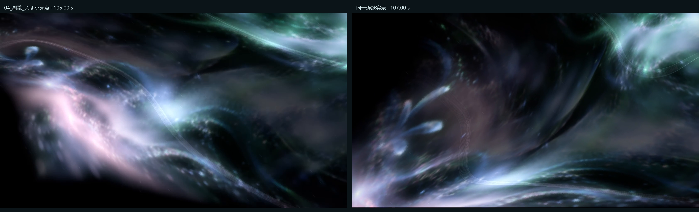
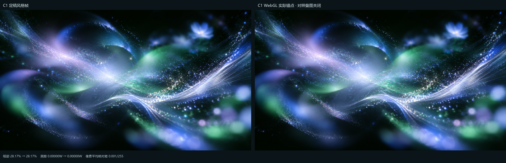
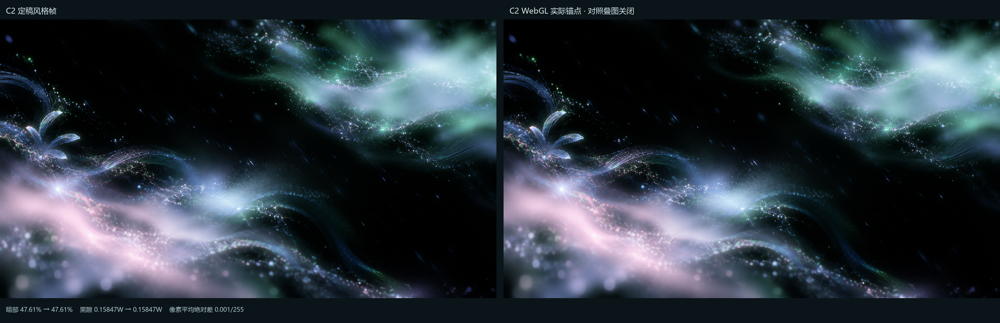
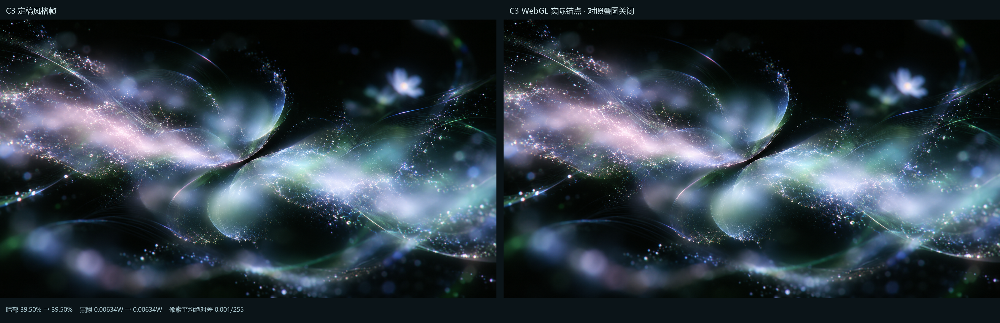
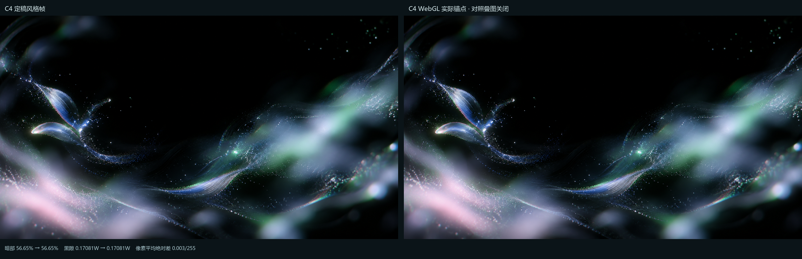

# 《晴天》Web 形体运动与风格帧对比报告

版本说明：本报告保存图像采样版此前完成的测量与录像。2026-11-16 按用户要求删除程序生成试验版后，已恢复对应源码和证据；本轮仅重新验证恢复后的功能，见 [恢复验证](evidence/restored-image-version.json)。下述整曲数据及十秒录像不是本轮重录。

2026-11-16。本报告对应最新“整个画面的运动”返工。旧版原地游移、闪烁、短寿命小点和六秒回原位窗口已经撤下。当前主形体由独立密集微粒共同进入大尺度流场，叠加两光分区旋转、反向漂移、伸展、惯性冲击与透视推进。不是整张图贴在网格上扭动。

## 1. 五项验收与直接证据

集中观看：[本机验收页面](http://127.0.0.1:47841/review.html)。需先启动本目录演示。录像含原曲，只放本地忽略目录，不能随 Git 克隆获得。

| 验收 | 证据 | 结果与边界 |
|---|---|---|
| 同段音频开 / 关各十秒 | [开](LocalOnly/验收/01_副歌_音频开.mp4)、[关](LocalOnly/验收/02_副歌_音频关.mp4) | 同为 105–115 秒副歌；两份都保留音乐，开关仅影响视觉驱动 |
| 间隔两秒形体改变 | [两帧对比](evidence/01_副歌_音频开_间隔2秒.png) | 从同一实录提取，暖色雾团、青色光体和程序光带明显换位、卷曲 |
| 主歌 / 副歌各十秒 | [主歌](LocalOnly/验收/03_主歌_音频开.mp4)、[副歌](LocalOnly/验收/01_副歌_音频开.mp4) | 40–50 秒 / 105–115 秒；源曲式标签仍为待听审工作标签 |
| 关闭所有额外小亮点 | [录像](LocalOnly/验收/04_副歌_关闭小亮点.mp4)、[两秒对比](evidence/04_副歌_关闭小亮点_间隔2秒.png) | 12,000 个小亮点槽绘制数为 0；主体微粒、光带和雨仍在运动 |
| 四锚点仍对应定稿 | [C1](evidence/C1_左右对比.png)、[C2](evidence/C2_左右对比.png)、[C3](evidence/C3_左右对比.png)、[C4](evidence/C4_左右对比.png) | 参考叠图关闭，实际 WebGL 输出；指标见后表 |

人工检查了上述实际画面：暖色团块从左侧向外涌动，青色光体转向伸展，黑色通道随两团关系改变，细丝随共同流场弯曲；关闭小亮点后仍可见这些形变。边缘硬切口在初次检查中被发现，已改为柔和消散后重新录制。这里只记录观察，不把它写成用户已经认可最终审美。

## 2. 实时录制与可复核数据

`tools/macro-proof.mjs` 在真实 Chrome 播放同源原曲，音频分析来自实时 AnalyserNode。Canvas.captureStream 与分析器后分出的 MediaStream 音轨一起录制；扬声器输出静音以免重复打扰，不会静音分析或录音。每段预热两秒，采集稍多于十秒以覆盖编码器启动延迟，再裁成十秒，没有插入静态补帧。完整轨迹与文件探测在 `evidence/macro-motion-recordings.json`。

| 片段 | 文件秒数 | 实播平均 fps | 形体相位速度 / 秒 | 宏观幅度均值 | 模糊后每 100ms 图像差 / 255 |
|---|---|---|---|---|---|
| 01_副歌_音频开 | 10.000 | 60.00 | 2.475 | 1.691 | 10.710 |
| 02_副歌_音频关 | 10.000 | 60.00 | 0.415 | 0.110 | 0.423 |
| 03_主歌_音频开 | 10.000 | 60.00 | 1.028 | 0.605 | 4.056 |
| 04_副歌_关闭小亮点 | 10.000 | 60.00 | 2.479 | 1.694 | 12.261 |

音频开 / 关的低通图像变化比为 **25.32×**；副歌 / 主歌为 **2.64×**。

方法：从实际录像按 10Hz 解码，缩到 418×235，再做相当于原画 12px 的高斯低通，以减少小亮点影响，计算相邻 RGB 帧的平均绝对差。该值包含亮度变化，**不是光流速度，也不是“好看程度”的评分**。相位速度和幅度来自实际渲染轨迹，单位是内部艺术参数，不冒充物理米每秒。大形体位置变化应直接看录像和两帧对比。

关闭小点时还对参考色彩属性做 σ=2.8px 低通，抑制采样图中的细小亮点；不声称连所有纹理高光都完全抹掉。雾体本身仍由微粒形成，因此“关闭小亮点”不等于把所有构成雾体的微粒关掉。

## 3. 锚点：相同尺度的实际截图测量

1672×941，O 叠图关闭。原图用于粒子位置与颜色属性，这是相似度很高的原因；不是无参考程序生成，也不是把原图复制为实际截图。精确锚点共同位移与相机偏移为零，但轨迹在前后继续穿过；测试验证附近斜率非零，已取消旧版六秒停靠窗口。

测量复用拆解的线性亮度 Y<0.01 暗部阈值，相同 A/B ROI、σ=12px 光中心重心，两光连线上 Y<0.015 的黑隙剖面。颜色为 ROI 亮度加权 sRGB，不是材质颜色。详见 `tools/compare.py` 和 `evidence/style-comparison.json`。

| 帧 / 锚点 | 暗部：原图 → 实际 | 黑隙宽：原图 → 实际 | 两光中心最大 UV 偏差 | RGB 平均绝对差 / 255 |
|---|---|---|---|---|
| C1 / 56.80s | 28.170% → 28.170% | 0.00000W → 0.00000W | 0.00000005 | 0.00095 |
| C2 / 93.61s | 47.614% → 47.613% | 0.15847W → 0.15847W | 0.00000011 | 0.00070 |
| C3 / 155.41s | 39.500% → 39.499% | 0.00634W → 0.00634W | 0.00000020 | 0.00127 |
| C4 / 264.05s | 56.648% → 56.645% | 0.17081W → 0.17081W | 0.00000115 | 0.00327 |

| 帧 | 光 A 原图 → 实际 | 光 B 原图 → 实际 |
|---|---|---|
| C1 | #9699CD → #9699CD | #93B6D4 → #93B6D4 |
| C2 | #AFA7C3 → #AFA7C3 | #81A9B5 → #81A9B5 |
| C3 | #A49CB6 → #A49CB6 | #90ACC1 → #90ACC1 |
| C4 | #A89EB7 → #A89EB7 | #7395A2 → #7395A2 |

逐张查看：C1 的交汇、右侧细丝与上方花，C2 的对角分离和宽暗区，C3 的中央细黑缝，C4 的上方留白与残瓣均保留。微小误差来自粒子核、浮点叠加和 GPU 精度，不能因为四舍五入相同就宣称绝对零误差。

## 4. 整曲、性能与离线备份

- 浏览器操作验证：**True**。播放、暂停、拖动、锚点、全屏、隐藏恢复、叠图透明度 37%、画质切换与窄屏均通过，页面错误 0。
- 整曲真实连续实播：**True**。0→269.747 秒，时钟单调，四章经过，无意外暂停，末尾自然停止。Chrome headless=True，扬声器静音=True，真实音频分析在静音节点之前。
- GPU：`ANGLE (Intel, Intel(R) Arc(TM) Graphics (0x00007D55) Direct3D11 vs_5_0 ps_5_0, D3D11)`。画面 1672×941，采集 16267 帧间隔，平均 **59.95fps**，p95 **17.00ms**，p99 **19.00ms**，超过 33.34ms 共 9 帧。
- 以上是当前本机 Chrome 数据，不保证其他硬件、浏览器或后台负载的性能；扬声器到耳朵的延迟没有麦克风闭环测量。
- 整曲离线备份：1600×900 / 60fps，16185 帧，H.264 + AAC，时长 269.750000 秒，文件 `LocalOnly/晴天_整曲备份.mp4`。
- 离线逐帧调用同一 WebGL 渲染器，使用 Unity 已有特征缓存，再合成原曲。交互版实时分析；二者的细部响应不保证逐帧相同。音频和视频均被 Git 忽略。
- 14 项 Node 测试通过：含 52 参数 / 82 分量四锚点等值、全曲范围、连续性、章节标签、真实输入影响、歌词包络、无完整歌词，以及新宏观导演的穿行、音频关闭、主副歌差异和惯性释放。

## 5. 实现边界与待确认

画面是参考引导的 2.5D 独立粒子重建，大尺度解析流场营造流体观感，未实现真实流体求解或从图像恢复真实三维体积。全部合同参数按原名计算，但部分原有雾纹、散景、景深仍在采样属性中，不是每个参数都变成独立 Web 材质层。实际连接和操作入口见 [README](README.md)，参考研究见 [动态参考调研](动态参考调研.md)。

用户待确认的是这一版形体涌动、冲击幅度和主副歌反差是否符合期望；工程证据不替代用户审美判断。Unity Assets / Packages / ProjectSettings 没有由本轮修改，原用户两份 Docs/Evidence 实播改动不混入提交。
